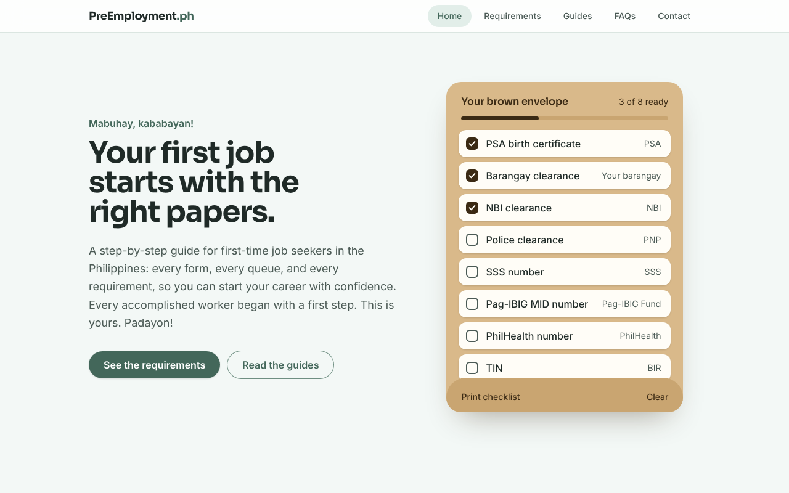
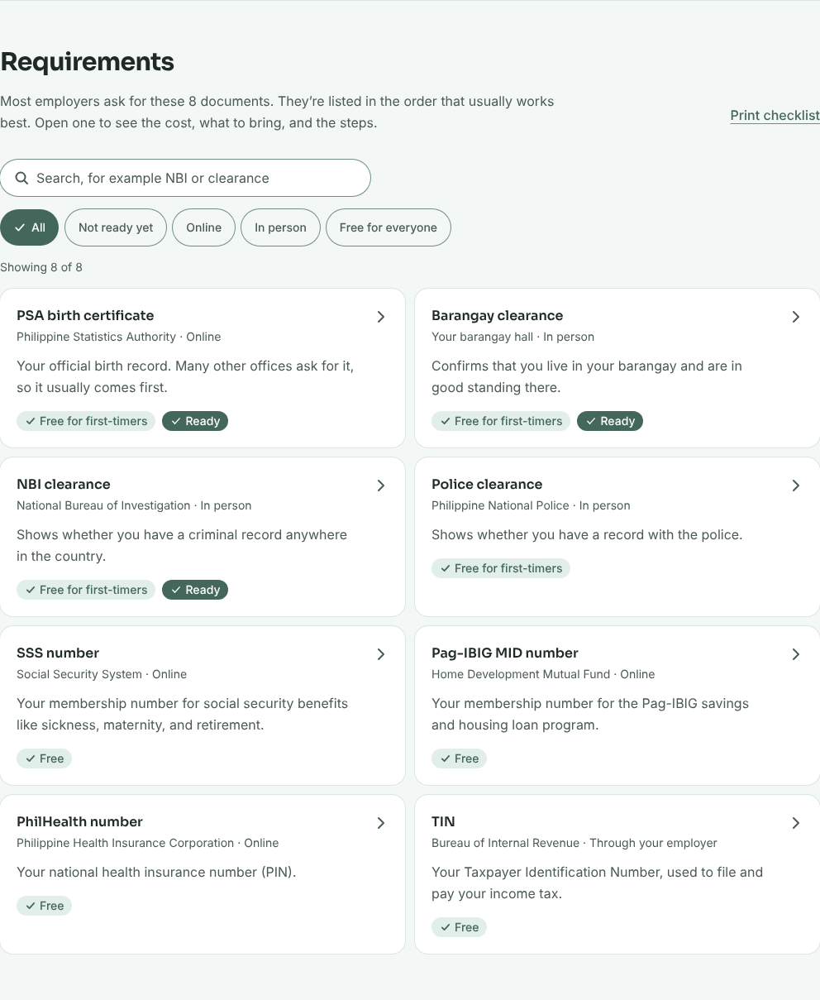
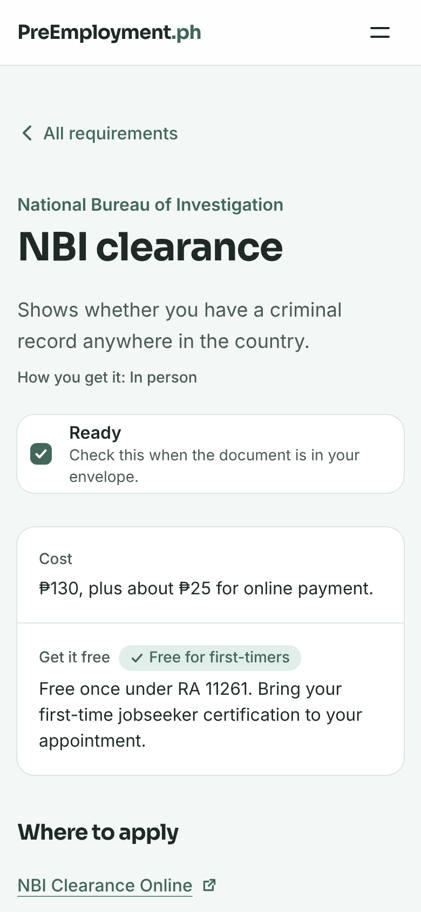
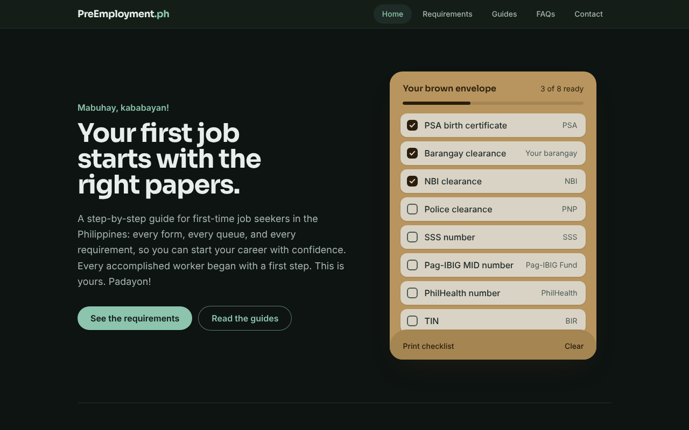

# 📋 PreEmployment.ph

*A complete guide for first-time job seekers in the Philippines.*



---

## 🌟 Overview

**PreEmployment.ph** walks **first-time job seekers** through every pre-employment requirement in the Philippines: what each document is, what it costs, what to bring, and the steps to get it.

It also explains the **First Time Jobseekers Assistance Act (RA 11261)**, which makes most government documents free once, and gives you a checklist you can tick off as you go, on your phone or on paper.

---

## ✨ Features

- **Your brown envelope:** a checklist of the 8 usual documents. Checkmarks are saved on your device.
- **A page for each requirement:** cost, how to get it free, official website, what to bring, steps, tips, and forms
- **Guides:** the RA 11261 free documents rules and the order that saves the most time
- **Search and filters:** find documents by name, or show only online, in-person, free, or not-ready-yet ones
- **Printable checklist:** one page with tickable boxes, ready to print or save as PDF
- **FAQs and contact:** quick answers, plus a way to report changed fees or steps
- **Built for everyone:** works on small phones and large text sizes, follows dark mode, and works with a keyboard and screen readers

| Requirements, with search and filters | A requirement on a phone | Dark mode |
| --- | --- | --- |
|  |  |  |

**Lighthouse scores** (mobile and desktop, home, requirement, and checklist pages): Performance 99–100, Accessibility 100, Best Practices 100, SEO 100.

---

## 🛠 Tech Stack

- **React 19:** component-based UI
- **Vite 7:** fast development server and build
- **Tailwind CSS 4:** styling with design tokens (light, dark, and high-contrast)
- **React Router 8:** a page for each requirement, plus the checklist
- **Sora** (self-hosted with `@fontsource-variable/sora`) for headings, the device's system font for body text

---

## 🚀 Getting Started

You need **Node.js 22.22 or newer** (check with `node -v`).

```bash
git clone https://github.com/DontReb/PreEmployment-ph.git
cd PreEmployment-ph
npm install
npm run dev
```

Then open the address shown in the terminal (usually http://localhost:5173).

| Command | What it does |
| --- | --- |
| `npm run dev` | Starts the development server with live reload |
| `npm run lint` | Checks the code for mistakes |
| `npm run build` | Builds the production site into `dist/` |
| `npm run preview` | Serves the built site locally to test it |

---

## ✏️ Updating the Content

All the content lives in `src/data/`, so you rarely need to touch the components:

| File | What's in it |
| --- | --- |
| `src/data/requirements.js` | Each document: cost, free option, official links, what to bring, steps, tips, forms |
| `src/data/guides.js` | The recommended order and the RA 11261 rules |
| `src/data/faqs.js` | Questions and answers |

Fees and processes change. When you re-check them on the official websites, also update `LAST_CHECKED` at the top of `requirements.js`. Every requirement page shows that date.

---

## 📂 Project Structure

```
PreEmployment-ph/
├── public/                  # Copied as-is: favicon, link preview image, robots.txt
├── src/
│   ├── components/          # Navbar, Envelope, sections (Requirements, Guides, FAQs, Contact)
│   │   └── ui/              # Small shared pieces: Icon, CostBadge, ReadyCheckbox
│   ├── data/                # All site content (see "Updating the Content")
│   ├── hooks/               # useActiveSection: highlights the section you're reading
│   ├── pages/               # HomePage, RequirementPage, ChecklistPage, NotFoundPage
│   ├── progress/            # Checklist progress, shared with React context, saved in localStorage
│   ├── App.jsx              # Layout and routes
│   ├── main.jsx             # Entry point
│   └── styles.css           # Tailwind and design tokens
├── docs/screenshots/        # Images used in this README
├── .env                     # VITE_SITE_URL, the public address used in link previews
├── vercel.json              # Vercel: lets /requirements/... links work when opened directly
└── index.html               # Page title, description, icons, link preview tags
```

---

## 🌐 Deploying

The site is static, so free hosting works well.

**Vercel (recommended)**
1. Sign in at [vercel.com](https://vercel.com) with GitHub and choose **Add New → Project**.
2. Import `DontReb/PreEmployment-ph`. Vercel detects Vite automatically.
3. Click **Deploy**. Every push to `main` deploys again automatically.

**Netlify** works too: import the repository, set the build command to `npm run build` and the publish directory to `dist`. `public/_redirects` is already set up.

After the first deploy, put your real address in `.env` (`VITE_SITE_URL=...`) so link previews on Facebook and Messenger show the right image.

---

## 🤝 Contributing

Suggestions, corrections, and new guides are welcome:

- Report outdated fees or steps in [Issues](https://github.com/DontReb/PreEmployment-ph/issues)
- Or fork the repository, create a feature branch, and open a pull request

---

## 📜 License

This project is licensed under the MIT License. You’re free to use, modify, and distribute it.

---

## 👨‍💻 Author & Maintainer
Liv Clarence A. Torres
📧 Email: ayentorres0503@gmail.com
🌐 [LinkedIn](https://www.linkedin.com/in/liv-clarence-torres-5b8650213/)

_"Every accomplished worker began with a first step. This is yours. Padayon!"_
